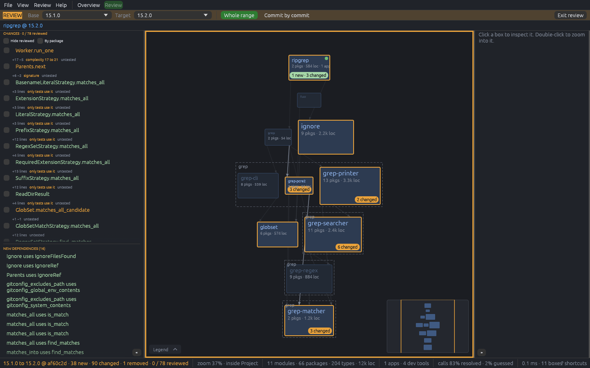
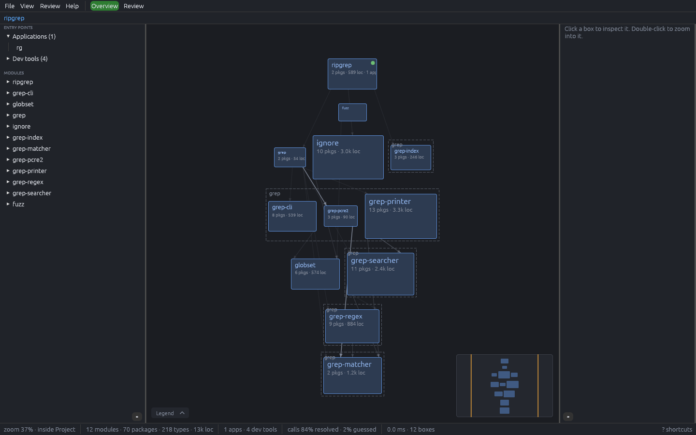
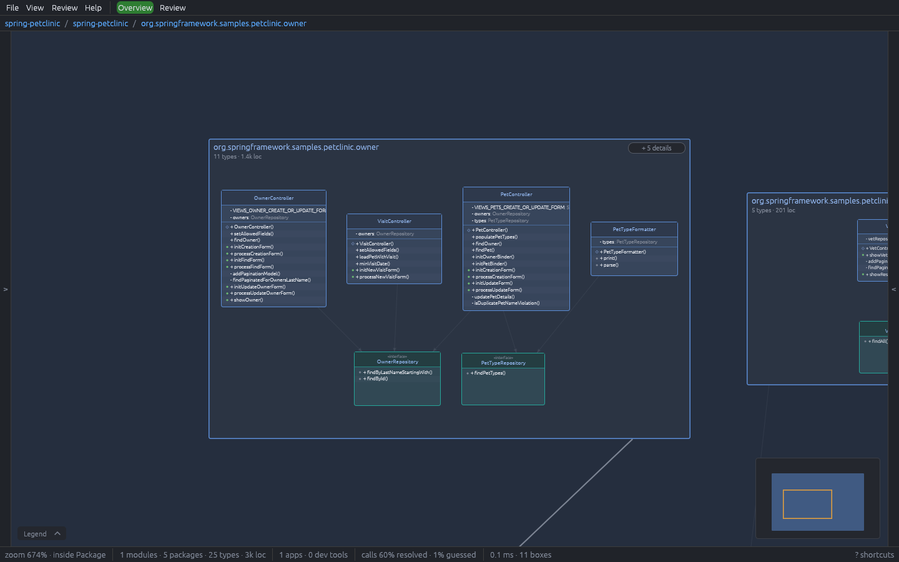
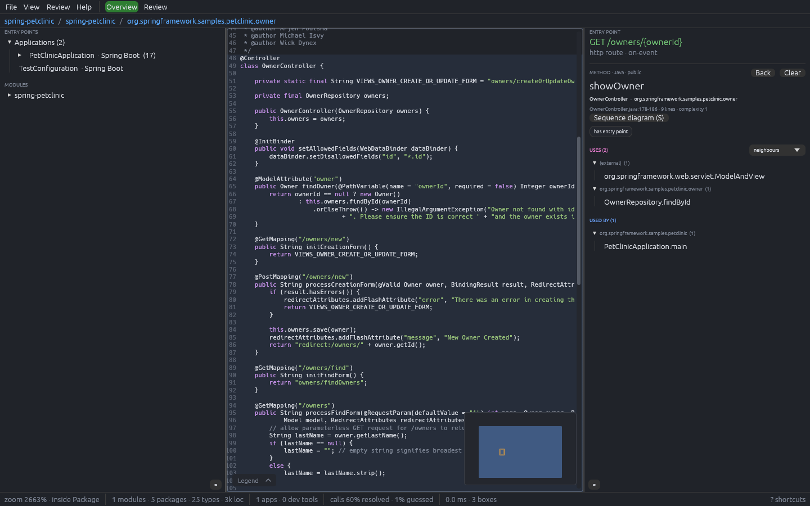
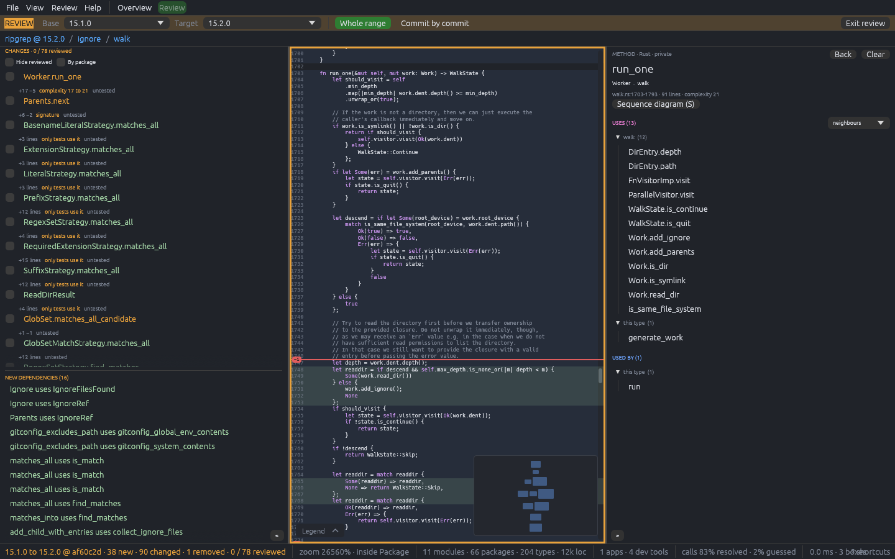
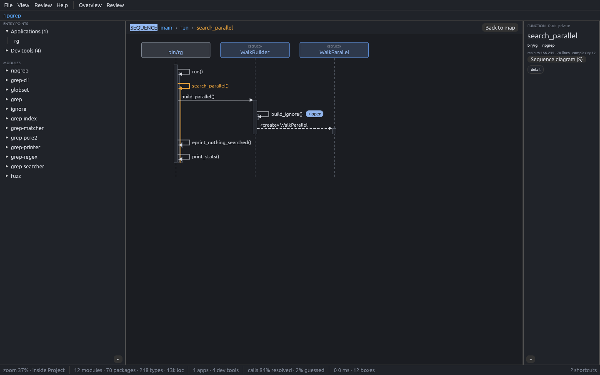
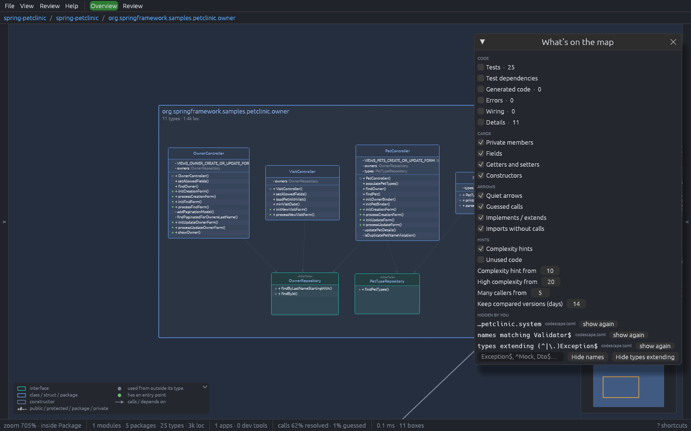

# CodeScape

[](https://github.com/bytewise-solutions/codescape/actions/workflows/ci.yml)

**See a whole codebase as one zoomable map, and review what changed on it.**

CodeScape reads a Java, Go, TypeScript/JavaScript or Rust project and draws it as a layered map: entry points on
top, modules below them by dependency, then packages, types and methods as you zoom in, down to the source itself.
Arrows that point upward, a lower layer depending on a higher one, are drawn red, so you see at a glance whether a
project is layered cleanly.

It was built to read code you did not write, and in particular to review what a coding agent changed on a branch:
the map shows what is new and changed, the list puts the riskiest changes first, and a sequence diagram tells any
method from the entry point that reaches it.



## Features

- **One map for the whole project.** Modules, packages, types and members nest inside each other and open as you zoom;
  zoom close enough and the type's file fills the map, where zoom sets the text size. Types are UML cards with their
  fields, methods and visibility. Only architectural types are drawn at first; data types and helpers wait behind
  `+ N details`.
- **Follow the code.** Click a box or a method: what it uses turns pink, what uses it blue, the rest dims. Walk the
  calls from the inspector, jump to any name with `Ctrl+K`, or double-click a method to open its file at that line.
  In an open file, `Ctrl`+click a name to go to its definition, `Ctrl+F` finds text and `Ctrl+Shift+O` lists its
  methods to jump to.
- **Review mode.** Compare any two versions: a branch with where it left `main`, two branches, or commit by
  commit. New blocks are green, changed ones amber with their line counts, new dependencies are drawn, and the list
  of changes is sorted by risk (complexity jumps, many callers, public signatures, untested, unused). Tick changes
  as reviewed; when the agent edits one again it comes back. Zoom into a file to see its added and removed lines.
- **Sequence diagrams.** Any method as a UML sequence diagram: the chain of callers from the nearest entry point,
  then its calls in the order they are written. Every arrow opens the code at that call.
- **Code quality hints.** Cyclomatic complexity on every function (amber from 10, red from 20), and unused code:
  blocks nothing calls, kept apart from public API and from code only tests use.
- **Make the map yours.** One panel decides what is drawn: tests, generated code, exceptions, wiring, details,
  what cards list (private members, fields, getters and setters), which arrows (guessed calls, implements,
  imports) and the hint thresholds. Right-click any box to hide it, its package or every name like it; the
  right panel says why something is hidden and can always show it.
- **Framework knowledge in rule packs.** Spring Boot, libGDX, Dagger, Google Wire, Fiber, RabbitMQ, Angular, Express
  and more are plain TOML files, so you can describe your own framework's entry points and routes.
- **Nothing written into your project.** The index (a memory-mapped file, about a quarter of the source size) and
  every compared version live in your cache folder.

## Screenshots

| | |
|---|---|
|  |  |
| **The map.** ripgrep's crates laid out top-down by dependency, entry point on top. | **UML cards.** Controllers above the repositories they call, with fields, methods, visibility and calls. |
|  |  |
| **Reading code.** Picking the route `GET /owners/{ownerId}` opens its controller and lists what it uses and what reaches it. | **Line diff in review.** `run_one` as changed between two ripgrep releases: added lines in green, removed ones marked in red. |
|  |  |
| **Sequence diagrams.** `search_parallel` told from `main`, crossing into the `ignore` crate. | **Your map, your rules.** Switch kinds of code, card rows and arrows on or off, and hide a package, every `…Validator`, or every type extending `Exception`. |

The screenshots show [ripgrep](https://github.com/BurntSushi/ripgrep) (MIT / Unlicense) and
[Spring PetClinic](https://github.com/spring-projects/spring-petclinic) (Apache-2.0), opened as they are.

## Install

Download the file for your system from the [releases page](https://github.com/bytewise-solutions/codescape/releases):

- **Linux** (x86-64): `CodeScape-<version>-x86_64.AppImage`. Make it executable (`chmod +x`) and run it. If it
  complains about FUSE, install `libfuse2` or start it with `--appimage-extract-and-run`.
  On its first start it adds a hidden
  `codescape.desktop` and its icon under `~/.local/share` so Wayland desktops can show the window's icon, unless a
  `codescape.desktop` is already installed (by `make install` or a package) in any of the XDG data folders. It
  updates that entry when the AppImage is moved or upgraded.
- **Windows** (x86-64): `codescape-<version>-x86_64.exe`. Run it directly; there is nothing to install.
- **macOS** (Apple Silicon and Intel): `CodeScape-<version>-macos.dmg`. Drag CodeScape to Applications. The app is not
  signed yet, so the first time right-click it ▸ **Open** and confirm, or run
  `xattr -d com.apple.quarantine /Applications/CodeScape.app`.

`SHA256SUMS` on the same page lists each file's checksum.

To build from source instead, you need a recent stable Rust (edition 2024) and a C compiler for the tree-sitter
grammars.

```sh
git clone git@github.com:bytewise-solutions/codescape.git
cd codescape
make build
```

This gives two binaries in `target/release`: `codescape`, the viewer, and `codescape-index`, the indexer on the
command line. The viewer draws with wgpu (Vulkan, Metal or DirectX 12), so it needs a GPU driver or a software one
such as Mesa's lavapipe. On Linux it runs on Wayland or X11. Review mode needs `git` and `tar` on the `PATH`.
On Linux, `make install` puts both binaries in `~/.local/bin` with a desktop entry and the icon, so CodeScape shows up
in the application menu and Wayland desktops give its window the right icon (`make uninstall` removes them; set
`PREFIX` to install elsewhere and `DESTDIR` to stage the files for a package). For a system-wide install, run
`make build` as yourself first, then `sudo make install PREFIX=/usr/local`: as root it installs what is built and does
not build.

## Quick start

```sh
codescape ~/path/to/project      # open a project folder
codescape                        # start screen: Open Folder… and recent projects
```

Point it at the project's root folder; every module under it is discovered and linked (Gradle, `go.mod`/`go.work`,
`package.json` workspaces, Cargo workspaces). The first open indexes the project, later ones are instant until a
source changes.

| To | Do |
|---|---|
| Move around | drag to pan, `Ctrl` + wheel or pinch to zoom, double-click a box to zoom into it |
| Inspect | click a box or a method row; the right panel lists what it uses and what uses it |
| Read the code | zoom into a type until its file opens, or double-click a method row; `Ctrl`+click a name to go to it |
| Review a branch | **Review** at the top, pick a base and a target in the orange bar |
| Tell a method | right-click it ▸ **Sequence diagram**, or select it and press `S` |
| Make room | `Ctrl+B` / `Ctrl+I` hide the left / right panel, `F11` both |
| See every shortcut | `?` or `F1` |

The [user guide](docs/user-guide.md) describes everything the map shows and every gesture.

## Command line

```sh
codescape-index ~/path/to/project            # index, then print modules, links, entry points and call resolution
codescape-index ~/path/to/project --unused   # also list unused code
codescape-index --help
```

`codescape --screenshot out.png` renders one frame without anyone at the window and exits; with `--focus`,
`--review`, `--sequence` and other flags it scripts a view first (see the [user guide](docs/user-guide.md#screenshots-without-a-person-at-the-window)).
CI uses it to check that the app renders.

## Configuration

Nothing is required. A `codescape.toml` in the project (shared with the team) or your own settings in
`~/.config/codescape/` can leave folders out, mark test code, define filters and categories, and turn rule packs
on or off; **File ▸ Project Settings…** edits them and shows which layer each value comes from. Rule packs teach
CodeScape about frameworks. Both are described in [docs/configuration.md](docs/configuration.md).

## How it works

```
crates/codescape-build    module discovery (Gradle, go.mod, go.work, package.json, Cargo)
crates/codescape-java     Java extractor            ┐
crates/codescape-go       Go extractor              │ tree-sitter: declarations, calls with their lines,
crates/codescape-ts       TypeScript / JavaScript   │ visibility, fields, complexity
crates/codescape-rust     Rust extractor            ┘
crates/codescape-facts    language-neutral facts handed from extractors to rule packs
crates/codescape-rules    rule pack loader and engine (entry points, routes, wiring, tags)
crates/codescape-format   the .codescape index: graph model, builder, memory-mapped reader (rkyv)
crates/codescape-index    indexing pipeline, settings, cache, comparison of versions, unused code, CLI
crates/codescape-layout   layered top-down layout per container
crates/codescape          the viewer (egui on wgpu): map, file view, review, sequence diagrams
crates/codescape-synth    generator of large synthetic projects for benchmarks
rules/                    built-in rule packs
```

Extractors turn each language into one graph of modules, packages, types and members with call, dependency and
implementation edges; rule packs add entry points and framework calls; the graph is written once to a compact,
memory-mapped file that the viewer lays out lazily, one container at a time. Scale numbers are in
[docs/benchmarks.md](docs/benchmarks.md).

## Development

```sh
cargo test --workspace                          # the whole suite, no external project needed
cargo test --workspace -- --include-ignored     # also index this repository itself
cargo fmt --all                                 # max width 160, see rustfmt.toml
cargo clippy --workspace --all-targets -- -D warnings
```

[CI](.github/workflows/ci.yml) runs on every pull request and on `master`: formatting, clippy with warnings denied,
the test suite, a headless render of this repository's map and of a sequence diagram (kept as artifacts), and
builds on macOS and Windows.

[Releases](.github/workflows/release.yml) are cut by pushing a tag that matches the workspace version in
`Cargo.toml`. From an up-to-date `master`, `make release` (or `make release type=patch`, `dry-run=true` to preview)
runs the checks, bumps the version, commits, tags and pushes; the workflow then runs the tests,
builds the AppImage, the Windows executable and the macOS disk image, and publishes them with `SHA256SUMS` and the
licences of every bundled crate (`THIRD-PARTY-LICENSES.txt`, from `cargo about`) as a GitHub release. Run it by hand from the Actions tab to build the same files as artifacts without publishing.

## Limits

- Calls are resolved from what the source states (imports, declared types, return types, element types of
  collections); there is no full type inference, so pattern bindings, tuples and generic results stay unresolved,
  and nothing inside Rust macros is read. The status bar shows the share of calls into your own code that were
  resolved, with library calls counted apart: about 60–80% for Java, Go and Rust, less for TypeScript test suites
  whose assertions run on untyped callback parameters.
- Overloaded methods share one row.
- Maven, Kotlin, Python and other languages are not indexed yet; their build roots are listed as skipped.
- Review matches blocks by name, so a renamed or moved block shows as removed plus new.

## License

[MIT](LICENSE). The release files bundle third-party crates under their own permissive licences (MIT, Apache-2.0,
Zlib, BSD and others, plus MPL-2.0 for `nucleo-matcher`); each release lists them in `THIRD-PARTY-LICENSES.txt`.
